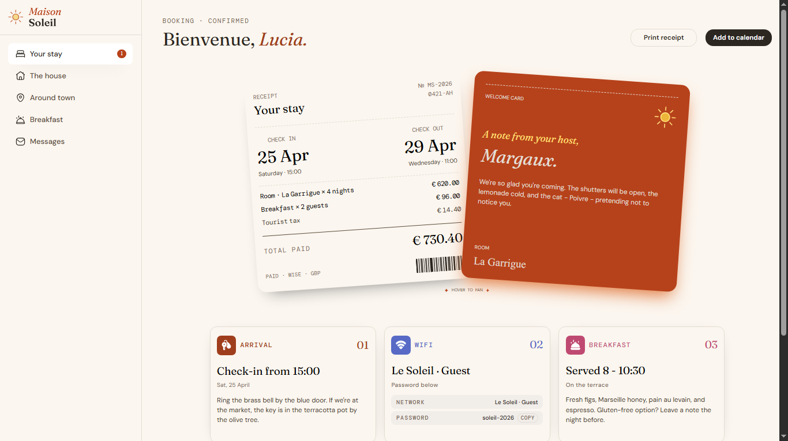

# 🏨 Hotel Booking Confirmation Page

  

A responsive hotel booking confirmation page built with HTML and CSS as part of a Frontend Mentor challenge.

## 📖 About the Challenge

This project is a solution to a Frontend Mentor challenge focused on creating a detailed hotel booking confirmation page.

The page includes a booking receipt, a welcome note from the host, and essential guest information such as arrival details, Wi-Fi credentials, and breakfast arrangements.

## ✨ Highlights

- 📱 Responsive layout for different screen sizes.
- 🧱 Semantic HTML structure.
- 🧭 CSS-only navigation menu using a checkbox.
- 🧾 Detailed booking receipt and welcome card.
- 🎨 Custom fonts and carefully styled layouts.
- ✨ CSS hover interactions using `:has()` and transitions.
- 📐 Modern CSS features, including logical properties and Flexbox and Grid layouts.

## 🛠️ Built With

  

## 💡 Key Takeaways

Throughout this project, I practiced:

- Structuring a detailed page using semantic HTML.
- Building responsive layouts with Flexbox and CSS Grid.
- Creating a CSS-only navigation menu using checkbox states.
- Working with modern CSS selectors, including `:has()`.
- Using CSS logical properties for more flexible layouts.
- Adding hover interactions with CSS transitions and transforms.
- Loading local custom fonts using `@font-face`.
- Organizing responsive designs with multiple media queries.

## 🔗 Links

- 🌐 **Live Site:** https://frontend-mentor-hotel-booking-confi-rho.vercel.app/
- 💻 **Repository:** https://github.com/Ziad-mo205/Frontend-Mentor---Hotel-booking-confirmation-page
- 🎯 **My Frontend Mentor Solution:** https://www.frontendmentor.io/solutions/responsive-page-using-flex-box-and-grid-BwXRmmtSMX